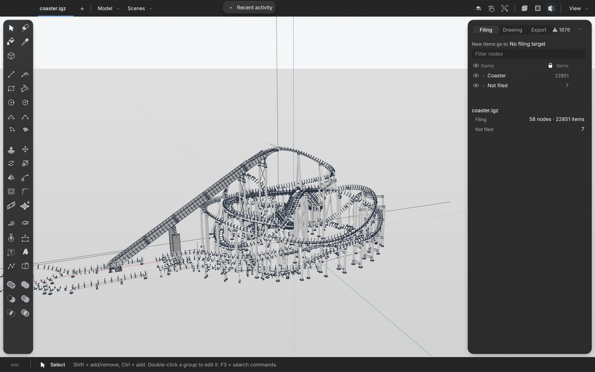
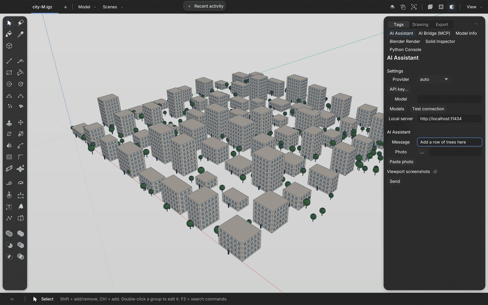
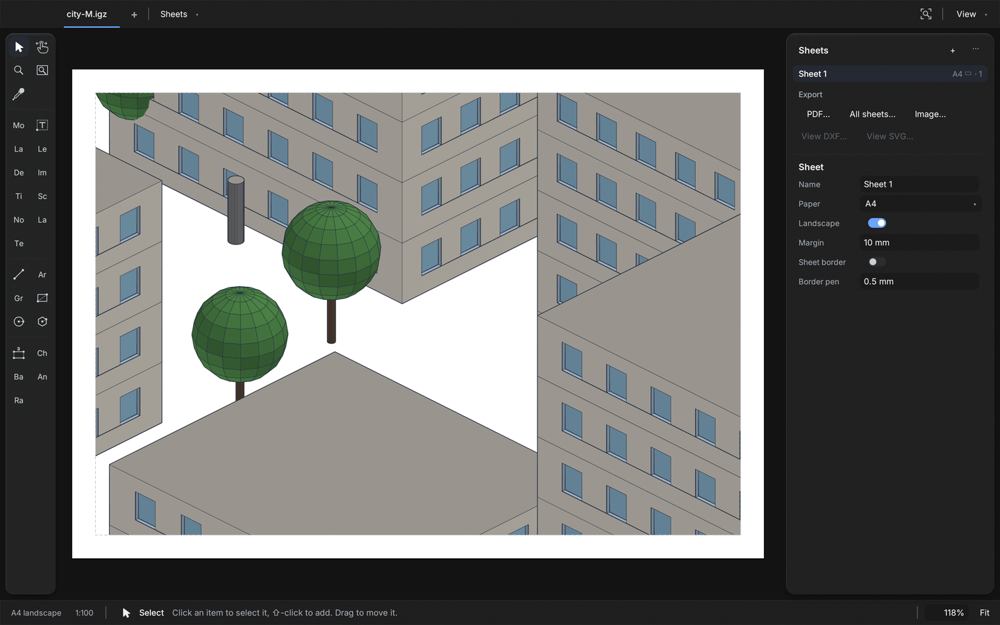

<h1 align="center">Built</h1>

<p align="center"><strong>Push/pull modelling at native speed, with BIM built in.</strong></p>

<p align="center">
  
</p>

Built is a native 3D modeller: draw faces, push and pull them into shape with inference guiding every click, and file each element for BIM and IFC as you go. It stays fast on models of millions of faces.

## Highlights

### Draw, push, pull


Draw a face and pull it into a solid. The cursor snaps to endpoints, edges and faces, and the arrow keys lock a line to an axis.
Offset, follow-me, fillet and solid operations work the same direct way, with the length typed or read as you go.
Groups and components keep a model organised, and a component edited once changes in every copy.

### Fast on very large models

The renderer runs on the GPU (wgpu, Metal on macOS) and culls there, so a model of several million faces stays interactive while you orbit, zoom and draw.
Edits stay local: changing one part does not rebuild the rest of the model.
The interface is drawn in the same frame as the model, and you navigate with trackpad gestures: slide and pinch to orbit, pan and zoom.

### BIM built in


One project tree files every element. A node carries the IFC class and type, tag, classification and default properties, and each element's record travels in the file.


Before export, the same tree shows node by node how many items are ready for IFC and what is missing.
Several models can share one project (`.builtproject`) and link each other, nested links included.

### Your AI, inside your model



Bring the assistant or agent you already use. Connect it through the built-in MCP bridge, or pick your provider in the assistant panel: Anthropic, OpenAI, Google Gemini, Groq, OpenRouter, DeepSeek, OpenCode Go, or a local server such as Ollama or LM Studio, with your own key.
Your AI works on the open document: it reads groups, tags, records and the project tree, looks at the viewport, draws and edits geometry, files elements, fills in records and classification, and exports IFC.
Each of its actions is one undo step, and code that fails is rolled back whole. The bridge listens on your machine only.

### Drawings and sheets



Section planes cut the model with fills and hatches. Scenes save views of the model to come back to.
The Sheets workspace places views of the model on paper at a scale, with dimensions, text and annotations, and exports PDF, DXF, SVG or an image.

### Works with your files

Opens `.built` and `.igz`. Imports `.skp` files with their materials, COLLADA, DXF, glTF/GLB, OBJ and STL.
Exports IFC (IFC4 and IFC4X3), glTF/GLB, COLLADA, OBJ, STL, and the current view as DXF, SVG or an image.
`.dwg` import needs an external converter and `.rfa` import needs its reader built; neither is in a default source build.

### Extend it with Python

Plugins are Python files or ZIP packages: they add tools, panels, menu entries and tools for your AI. See [`docs/plugins.md`](docs/plugins.md).
A Python console runs on the open document, with each run as one undo step.
The bundled plugins are the AI assistant, the MCP bridge, the console, a model summary, a solid inspector and rendering through Blender.

## Everything else

<table>
<tr>
<td valign="top" width="33%">

**Modelling**

- Line, freehand, arcs, rectangle, circle, polygon
- Push/pull, offset, follow-me, fillet
- Move, rotate, scale, flip
- Union, subtract, intersect, trim, split, outer shell
- Tape, protractor, dimensions, text
- Groups and components
- Paint with colour or image materials (PBR)

</td>
<td valign="top" width="33%">

**BIM and projects**

- Project tree with Filing, Drawing and Export columns
- A record per object, stored in the file
- Classification systems, types and systems
- IDS checks (needs `ifcopenshell`)
- IFC4 and IFC4X3 export
- Linked files that reload when the source changes
- `.builtproject` shared projects

</td>
<td valign="top" width="33%">

**Views and output**

- Section planes, fills and hatches
- Scenes
- Styles: shaded, hidden line, wireframe, X-ray, monochrome
- Parallel, perspective and two-point projection
- Shadows and north
- Sheets to PDF, DXF, SVG and image
- Rendering through Blender (needs Blender)

</td>
</tr>
<tr>
<td valign="top">

**AI**

- Assistant panel with your provider and key
- MCP bridge for your own agent
- Reads and edits records, structure and geometry
- Viewport screenshots for the model to look at
- Every action is one undo step

</td>
<td valign="top">

**Extending**

- Python plugins and a plugin API
- Python console on the open document
- Plugins can add panels, tools and agent tools
- Command palette (⌘K or F3)

</td>
<td valign="top">

**Platform**

- Native, written in Rust
- GPU renderer on wgpu
- Trackpad and touch-screen navigation
- 64-bit coordinates in `.built`
- Interface in 19 languages
- Terrain profile and georeferenced paths

</td>
</tr>
</table>

More detail in [`docs/features.md`](docs/features.md).

## Status

Pre-release, with no public download yet. Built runs on macOS on Apple silicon; Linux and Windows builds are in progress.

## Formats

Saves `.built` ([format](docs/built-format.md)), opens `.igz`, imports `.skp` files, and exports [IFC](docs/ifc-export.md) (IFC4 and IFC4X3). The full list is under [Works with your files](#works-with-your-files).

## Build from source

<details>
<summary>Commands (Python 3.13 and a Rust toolchain)</summary>

```bash
python3.13 -m venv .venv
.venv/bin/python -m pip install -r requirements.txt
VENV=.venv scripts/build_native.sh                                  # the Rust kernel and renderer, as Python extensions
cargo build --release --manifest-path rust/built_app/Cargo.toml     # the application
rust/built_app/target/release/built --root . --venv .venv           # run it from the checkout
```

For the macOS application bundle, with PyInstaller and ifcopenshell installed in the same environment:

```bash
packaging/build-macos-native.sh dist    # writes dist/Built.app
```

IDS checks need `ifcopenshell`, which `requirements.txt` does not install.

</details>

## Tests

See [`docs/testing.md`](docs/testing.md) for the test selections and what each one needs.

## Extensions

Built will have its own extension repository and website; neither is open yet. IngeTrazo extensions are not supported.

## License and credits

Built is free software under the GNU General Public License, version 3 or later ([`LICENSE`](LICENSE)). It began as a fork of IngeTrazo and contains its code and history: credit for the upstream project goes to Marco Sumari Tellez and IngeTrazo contributors. All authors are listed in [`AUTHORS`](AUTHORS) and keep their copyright.
