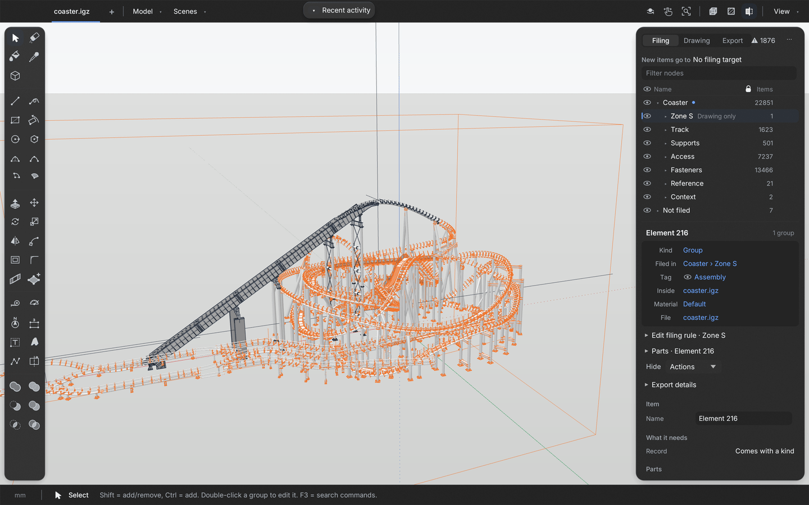
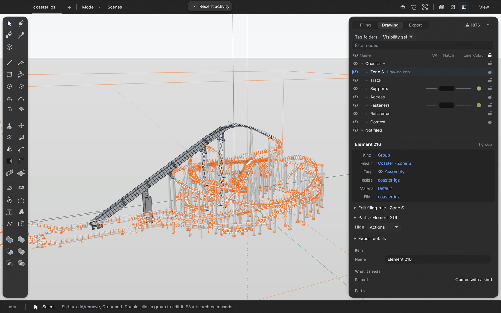
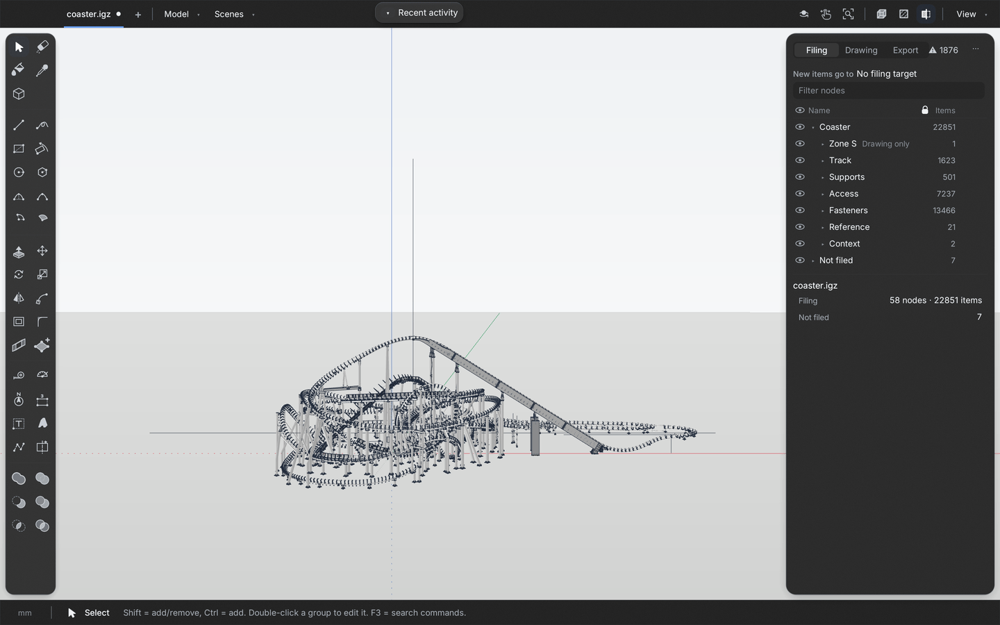

# Built

Built is a native 3D modeller for as-built and construction work, written in Rust. You model by drawing and push/pull, file every element once in a project tree, and export IFC from that tree. It runs on macOS (Apple Silicon); Linux and Windows builds are in progress.


Built is pre-release. There is no public download yet; you build it from source.

## Screenshots

| | |
|---|---|
|  |  |
| **Drawing with inference.** The Line tool snaps to an endpoint and shows the length as you move. | **Project tree and record.** A selected element shows where it is filed, its tag, material and file. |
|  |  |
| **Drawing columns.** The same tree sets line weight, hatch and colour per node. | **Export checks.** Each node shows how many of its items are ready for IFC, with a checklist of what to fix. |



## What works today

- **Modelling.** Line, arc, rectangle, circle, polygon, push/pull, offset, follow-me, move, rotate, scale, fillet, solid operations, tape, protractor, dimensions and text, with point, edge, face and axis inference.
- **Large models.** The renderer (wgpu, Metal on macOS) culls on the GPU and draws the interface in the same frame. Models of several million faces at survey coordinates stay workable.
- **Project tree.** One tree with three column sets: Filing, Drawing and Export. A node carries a recipe (IFC class and type, tag, classification, default properties), and the elements filed under it follow.
- **Records and checks.** Each object has a record stored in the file. Problems are listed per node before export.
- **Linked files.** A project can link other documents, nested links included, and reloads them when the source changes.
- **Sections and sheets.** Section planes with fills and hatches, scenes, and a sheet composer for drawings.
- **Scripting.** Python plugins and an agent bridge (MCP) work on the same documents.

## Formats

| Format | Support |
|---|---|
| `.built` | Built's own format: a ZIP with JSON and binary geometry, 64-bit coordinates. See [`docs/built-format.md`](docs/built-format.md). |
| `.igz` | Opens. These are the files of the modeller Built grew from. |
| `.skp` | Imports `.skp` files, with their materials. |
| IFC | Exports IFC4 (and IFC4X3) from the object records. IDS checks need `ifcopenshell`, which `requirements.txt` does not install. See [`docs/ifc-export.md`](docs/ifc-export.md). |

## Building from source

You need Python 3.13 and a Rust toolchain (rustup).

```bash
python3.13 -m venv .venv
.venv/bin/python -m pip install -r requirements.txt
VENV=.venv scripts/build_native.sh                                  # the Rust kernel and renderer, as Python extensions
cargo build --release --manifest-path rust/built_app/Cargo.toml     # the application
rust/built_app/target/release/built --root . --venv .venv           # run it from the checkout
```

To build the macOS application bundle, with PyInstaller and ifcopenshell installed in the same environment:

```bash
packaging/build-macos-native.sh dist    # writes dist/Built.app
```

## Tests

```bash
export HOME=$(mktemp -d) BUILT_SETTINGS_DIR=$(mktemp -d)    # never the real profile
.venv/bin/python -m pytest -n 8 -m "not slow" tests
```

[`docs/testing.md`](docs/testing.md) describes the selections, the window tests and what each one needs.

## Extensions

Built will have its own extension repository and website; neither is open yet. IngeTrazo extensions are not supported.

## Licence and credits

Built is free software under the GNU General Public License, version 3 or later. See [`LICENSE`](LICENSE).

Built began as a fork of IngeTrazo and contains its code and history. Credit for the upstream project goes to Marco Sumari Tellez and IngeTrazo contributors. All authors are listed in [`AUTHORS`](AUTHORS) and keep their copyright.
