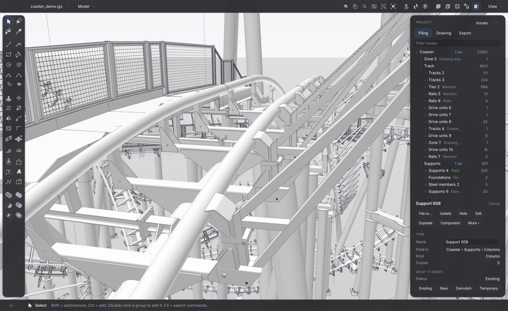
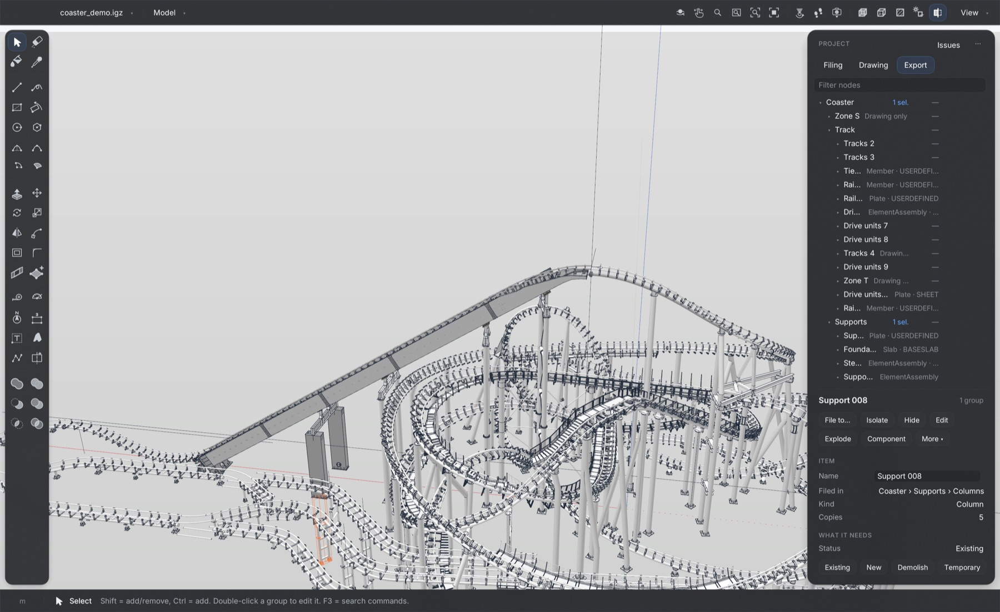
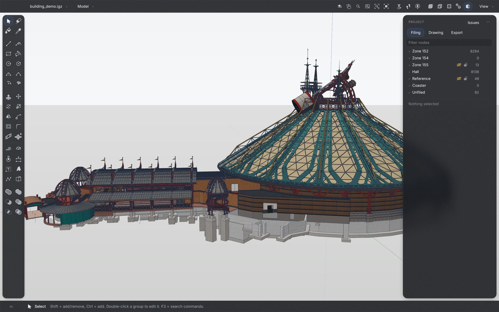
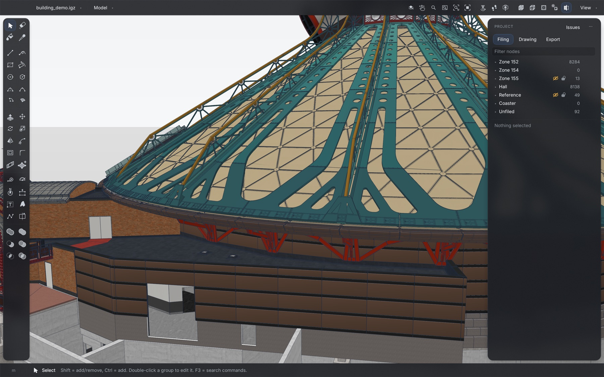

# Built

**A 3D modeller for as-built work and the structure behind it.** You draw freely with push/pull. Every element is filed once in a project tree, and from there the file exports to IFC that passes its checks.



> Built is a fork of [IngeTrazo](https://github.com/ingelibre/ingetrazo), the GPL-3 push/pull modeller from Peru. It keeps IngeTrazo's modelling and still opens its `.igz` files. It moves the geometry kernel and the renderer to Rust, draws a new interface inside the 3D view, and rethinks the workflow around projects that end up as IFC. The two projects share history and the GPL-3.0-or-later licence. Upstream fixes are still merged.


-informational)

## Status

Pre-release. Built is used every day on real as-built projects: linked models of several million faces at survey coordinates. There is no public release yet. macOS on Apple Silicon is the only platform tested. The renderer uses wgpu, so Linux (Vulkan) and Windows (DX12) are within reach but untested.

## What it looks like

| | |
|---|---|
|  |  |
| **Export columns.** The same tree shows the IFC class and predefined type each node gives its items. | **Large textured models.** A show building of about 15,900 definitions, drawn on Metal. |



*The screenshots use copies of real as-built models with every name, tag and material replaced by a generated label.*

## The interface

The interface is drawn by the renderer itself, inside the 3D view, on four fixed slabs:

- **Top bar.** Document, workspace, scenes, navigation, display toggles and the View menu.
- **Tool rail** on the left, with every tool visible.
- **Project dock** on the right. It holds the tree (Filing, Drawing and Export column sets, filters, Problems mode) and an inspector for the selection that you edit in place.
- **Bottom bar.** Units, the active tool's options and hint, and the value you type.

The command palette is ⌘K or F3. The classic Qt layout is still there with `BUILT_UI=0` while the last panels are ported.

## Where it stands on Rust

| Part | Today | Notes |
|---|---|---|
| Viewport renderer (`rust/ingetrazo_render`) | **Rust**, wgpu on Metal | GPU culling and indirect draws; the new UI (egui) is drawn in the same frame |
| Modelling kernel (`rust/ingetrazo_core`) | **Rust** | Every mesh lives in a Rust store with true f64 coordinates: push/pull, offset, sweep, intersect, fillet, bevel, solids, split, explode, purge |
| Core protocol | Python over the Rust store | Commands, queries and a change feed keyed by stable element keys. The UI and the agent (MCP) bridge use the same seam. See [`docs/core-protocol.md`](docs/core-protocol.md) |
| Tools, records, IFC vocabulary | Python | Move to Rust where a measurement on a real model says Python is what costs the time |
| IFC (ifcopenshell), .skp reader (OpenSKP), Revit families (rvt-rs) | C++ / Rust / Python | Used as they are |

On the reference as-built model (8.5 M triangles, 76 k placements), a frame takes about 8 ms. The OpenGL view it replaced took 270–1,200 ms per frame while orbiting.

## How Built differs from IngeTrazo

- **Own format.** A `.built` file is a ZIP like `.igz`, with f64 points and transforms, so survey coordinates stay exact to the micrometre. `.igz` files still open. *Save a Copy as IngeTrazo (.igz)* writes float32 and warns when rounding moves points.
- **Project structure.** The project is one tree that you edit. Each node carries a recipe: IFC class and predefined type, tag, classification, system and default properties. You file an element once and the rest follows from its node. See [`docs/project-structure.md`](docs/project-structure.md).
- **Records and IFC.** Each object has a record stored in the file. Problems are checked against an IDS before export, so the IFC needs no cleanup pass.
- **Linked files.** A composite project links other files, nested links included. When a source changes on disk, the composite reloads it in place.
- **Tags by key.** Tags and tag folders are known by a stable key, and the name is only a label.
- **Materials.** PBR (metallic, roughness, normal, AO), read from .skp files and carried through to glTF.
- **Imports.** Revit families (`.rfa`) through [rvt-rs](https://github.com/DrunkOnJava/rvt-rs), alongside everything IngeTrazo opens.
- **Touch and trackpad.** On a touch screen a slide orbits, and the trackpad still zooms.
- **Big files.** Edits never repack nested models, the snap index is built off the main thread, and large saves stream to disk.

What stays the same as IngeTrazo: push/pull modelling and inference, the sheet composer, terrain and georeferencing, and the plugin and MCP agent bridge.

## How Built differs from .skp

Built follows the push/pull way of modelling. It is not a clone and has no affiliation with Trimble.

| | .skp | Built |
|---|---|---|
| Licence | proprietary subscription | GPL-3.0-or-later, free |
| Works offline | partly | fully, no account |
| File format | closed `.skp` | open `.built` (ZIP + JSON + binary geometry). Built also opens `.skp` |
| Precision | single precision | f64 points; survey coordinates stay exact |
| Organising a model | tags, outliner and an IFC classifier, kept separately | one project tree that derives tags, IFC classes and properties |
| IFC | export through classifications | a record per object, IDS checks, export driven by the tree |
| Large models | single-threaded OpenGL | Rust/wgpu renderer with GPU culling |
| Linked files | references, reloaded by hand | linked files that reload in place, nested links included |
| Scripting | Ruby API | Python plugins plus an MCP agent bridge |

.skp is a trademark of Trimble Inc. It is named here only for comparison.

## Building from source

```bash
python3.13 -m venv .venv && source .venv/bin/activate
pip install -r requirements.txt
scripts/build_native.sh        # needs rustup + maturin; builds the Rust kernel and renderer
INGETRAZO_WGPU=1 INGETRAZO_RUST=1 python main.py
```

The Revit family reader needs an [rvt-rs](https://github.com/DrunkOnJava/rvt-rs) checkout next to this repository. Without it, `.rfa` import reports the reader as missing. To build a macOS app bundle: `packaging/build-macos-app.sh dist`.

Internal names (`ingetrazo_core`, `ingetrazo_render`, the `INGETRAZO_*` variables, the `ingetrazo` executable) are kept for now so settings and existing setups carry over.

## Credits and licence

Built is GPL-3.0-or-later, like IngeTrazo. It contains IngeTrazo's code and history. All upstream authors are listed in [`AUTHORS`](AUTHORS) and keep their copyright. Credit for the modeller this grew from goes to Marco Sumari Tellez, the IngeTrazo project and its contributors: [ingelibre/ingetrazo](https://github.com/ingelibre/ingetrazo).
