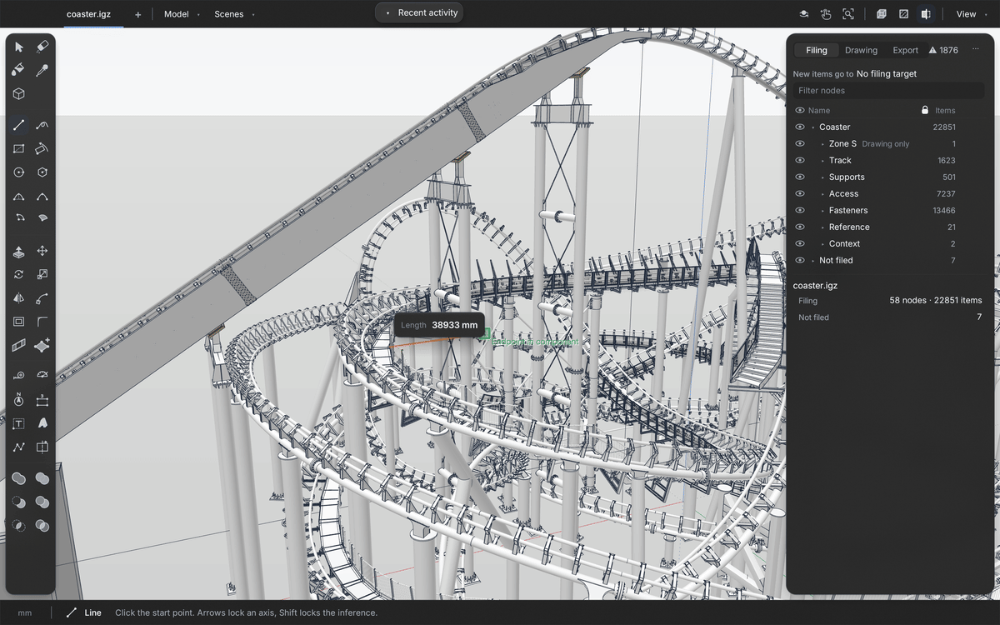
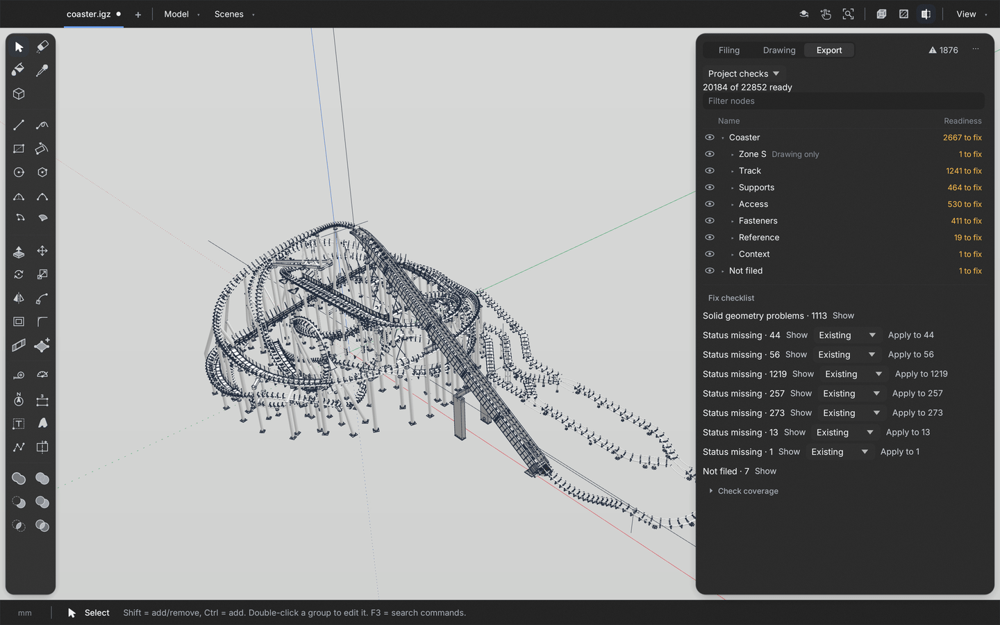

<h1 align="center">Built</h1>

<p align="center"><strong>Draw what was built, file each element once, export IFC.</strong></p>

<p align="center">
  
</p>

Built is a native 3D modeller for as-built and construction work, written in Rust. You model by drawing and push/pull, and the same file holds the project tree and the record of every element.

## Highlights

### Stays workable on very large models



The renderer runs on the GPU (wgpu, Metal on macOS) and culls there, so models of several million faces can be drawn and edited.
Inference keeps working at that size: the Line tool here snaps to an endpoint and shows the length.

### One project tree files every element


Each node of the tree carries a recipe: IFC class and type, tag, classification and default properties.
File an element under a node once, and its tag, record and export follow.

### Checks before IFC



The Export columns show, node by node, how many items are ready and what is missing.
You fix the list in the model, then export.

More in [`docs/features.md`](docs/features.md).

## Status

Pre-release, with no public download yet. Built runs on macOS on Apple silicon; Linux and Windows builds are in progress.

## Formats

Saves `.built` ([format](docs/built-format.md)), opens `.igz`, imports `.skp` files, and exports [IFC](docs/ifc-export.md) (IFC4 and IFC4X3).

## Build from source

<details>
<summary>Commands (Python 3.13 and a Rust toolchain)</summary>

```bash
python3.13 -m venv .venv
.venv/bin/python -m pip install -r requirements.txt
VENV=.venv scripts/build_native.sh                                  # the Rust kernel and renderer, as Python extensions
cargo build --release --manifest-path rust/built_app/Cargo.toml     # the application
rust/built_app/target/release/built --root . --venv .venv           # run it from the checkout
```

For the macOS application bundle, with PyInstaller and ifcopenshell installed in the same environment:

```bash
packaging/build-macos-native.sh dist    # writes dist/Built.app
```

IDS checks need `ifcopenshell`, which `requirements.txt` does not install.

</details>

## Tests

See [`docs/testing.md`](docs/testing.md) for the test selections and what each one needs.

## Extensions

Built will have its own extension repository and website; neither is open yet. IngeTrazo extensions are not supported.

## License and credits

Built is free software under the GNU General Public License, version 3 or later ([`LICENSE`](LICENSE)). It began as a fork of IngeTrazo and contains its code and history: credit for the upstream project goes to Marco Sumari Tellez and IngeTrazo contributors. All authors are listed in [`AUTHORS`](AUTHORS) and keep their copyright.
