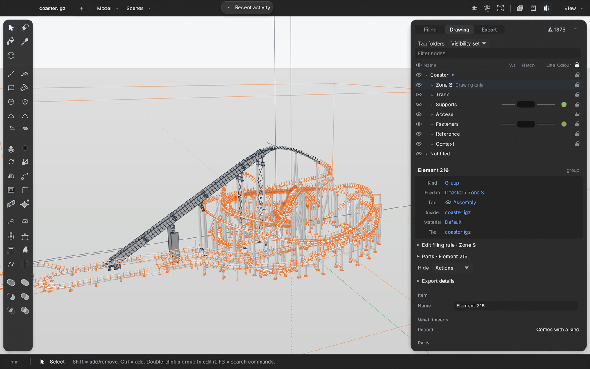

# What works today

Built is pre-release. This is what the current build does on macOS.

## Modelling

- Line, arc, rectangle, circle, polygon, push/pull, offset, follow-me, move, rotate, scale, fillet, solid operations, tape, protractor, dimensions and text.
- Point, edge, face and axis inference while you draw.
- Section planes with fills and hatches, scenes, and a sheet composer for drawings.

## Large models

- The renderer (wgpu, Metal on macOS) culls on the GPU and draws the interface in the same frame.
- Models of several million faces at survey coordinates stay workable.

## Project tree

- One tree with three column sets: Filing, Drawing and Export.
- A node carries a recipe: IFC class and type, tag, classification and default properties. The elements filed under it follow.
- The Drawing columns set line weight, hatch and colour per node.

## Records and checks

- Each object has a record stored in the file.
- Problems are listed per node before export, with a checklist of what to fix.

## Linked files

- A project can link other documents, nested links included, and reloads them when the source changes.

## Scripting

- Python plugins and an agent bridge (MCP) work on the same documents. See [`plugins.md`](plugins.md) and [`ai-bridge.md`](ai-bridge.md).

## Formats

| Format | Support |
|---|---|
| `.built` | Built's own format: a ZIP with JSON and binary geometry, 64-bit coordinates. See [`built-format.md`](built-format.md). |
| `.igz` | Opens. These are the files of the modeller Built grew from. |
| `.skp` | Imports `.skp` files, with their materials. |
| IFC | Exports IFC4 (and IFC4X3) from the object records. IDS checks need `ifcopenshell`, which `requirements.txt` does not install. See [`ifc-export.md`](ifc-export.md). |
